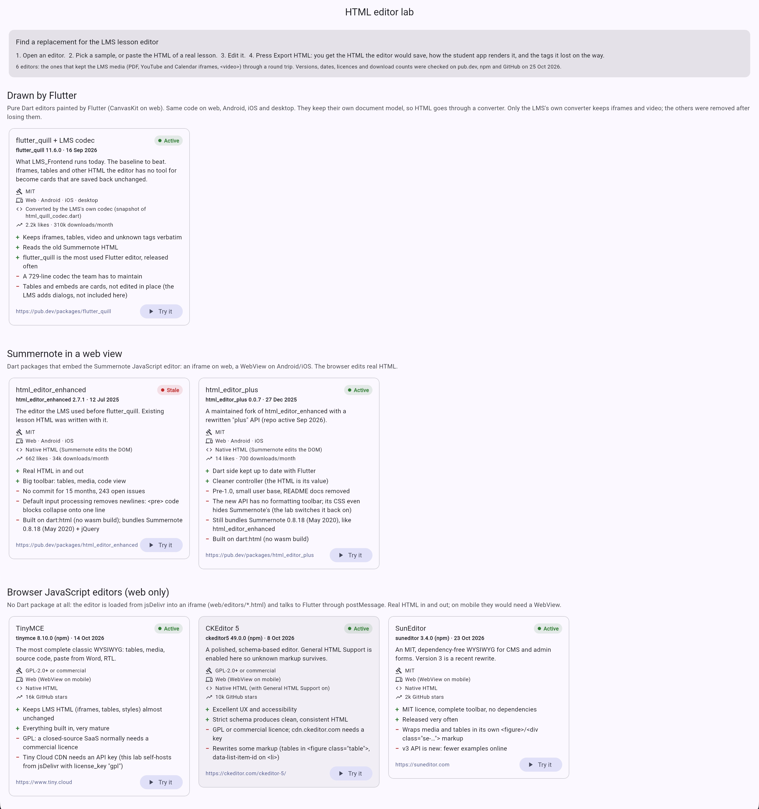

# Flutter_web_Testing_HTML_Editors: HTML editor lab

**The updated and maintained HTML editors for Flutter web**, tested side by side. Every editor here had a
release or a commit in 2026 (checked on 25 Oct 2026), except `html_editor_enhanced` (last release July 2025),
kept as a baseline because a lot of existing HTML was written with it.

A Flutter playground for anyone who needs a rich-text / HTML editor on **Flutter web**: open each one, load
the same HTML, edit it, and see what it saves.

Only the editors that **keep embedded media** are left: PDF, YouTube and Google Calendar `<iframe>`s and
`<video>` must survive loading and saving.

Everything is static: no backend, no login. Each editor is loaded with sample HTML (formatted text, media,
tables, Arabic RTL, old Summernote output), or with any HTML you paste.



## Run it

```bash
flutter pub get
flutter run -d chrome --web-hostname localhost --web-port 5077
```

- `/`: every editor, with version, release date, licence, platforms and pros/cons.
- `#/editor/<id>?sample=<sample>`: one editor, e.g. `#/editor/tinymce?sample=media`.
  Samples: `lesson`, `media`, `table`, `rtl`, `summernote`, `empty`. **Paste HTML…** loads your own.
- **Export HTML** shows the HTML the editor would save, how `flutter_widget_from_html` renders it, and a tag-by-tag round-trip count of what was lost or added.
- `flutter test -r expanded` runs the flutter_quill HTML codec over every sample.

TinyMCE, CKEditor 5 and SunEditor load from jsDelivr, so they need internet.

## The 6 editors

| Family | Editor (`id`) | Runs on |
| :-- | :-- | :-- |
| Drawn by Flutter | flutter_quill + HTML codec (`flutter-quill`) | web, Android, iOS, desktop |
| Summernote in a web view | html_editor_enhanced (`html-editor-enhanced`) | web, Android, iOS |
| Summernote in a web view | html_editor_plus (`html-editor-plus`) | web, Android, iOS |
| Browser JS editor in an iframe (`web/editors/*.html`) | TinyMCE (`tinymce`) | web (mobile would need a WebView) |
| Browser JS editor in an iframe | CKEditor 5 (`ckeditor5`) | web (mobile would need a WebView) |
| Browser JS editor in an iframe | SunEditor (`suneditor`) | web (mobile would need a WebView) |

## Free or paid

### Free (open-source licence, no key, no subscription)

| Editor | Licence | Notes |
| :-- | :-- | :-- |
| flutter_quill + HTML codec | MIT (`flutter_quill`, `flutter_quill_extensions`) | Free for commercial use. |
| html_editor_enhanced | MIT (Summernote inside is MIT too) | Free for commercial use. |
| html_editor_plus | MIT (Summernote inside is MIT too) | Free for commercial use. |
| SunEditor | MIT | Free for commercial use; self-host it or load it from any CDN, no account. |

The lab's other packages are free as well: `flutter_widget_from_html` (MIT), `html` (MIT), `web` and
`flutter_lints` (BSD-3-Clause), Flutter itself (BSD-3-Clause).

### Needs a licence or a subscription

Both are dual-licensed: **GPL-2.0-or-later** or a **commercial licence**. The GPL route is meant for
GPL-compatible (open-source) projects; for a closed-source app or SaaS, plan on a commercial plan, or ask a
lawyer before relying on the GPL. Prices below are in USD, as shown on the vendors' pricing pages on 25 Oct 2026.

| Editor | Free option | Paid plans |
| :-- | :-- | :-- |
| TinyMCE | **Open Source**: self-hosted, GPL2+ (what this lab uses, `license_key: 'gpl'`). **Cloud Free**: 1,000 editor loads/month, one domain, no commercial licence listed. | **Essential** $79/month (billed annually): 5,000 loads/month, commercial licence. **Professional** $145/month (billed annually): 20,000 loads/month. Extra loads $40 per 1,000. **Enterprise**: custom quote, the plan that offers self-hosting. ([pricing](https://www.tiny.cloud/pricing/)) |
| CKEditor 5 | **GPL**: self-hosted, for GPL2+-compliant projects (what this lab uses, `licenseKey: 'GPL'`). **Cloud Free**: 1,000 editor loads/month, commercial licence for one application, "Powered by CKEditor" badge, US region; read-only for the rest of the month past the limit unless a card is on file ($60 per extra 1,000). | **Essential** $160/month ($144 billed annually): 5,000 loads/month. **Professional** $319/month ($289 billed annually): 20,000 loads/month, collaboration add-on. **Custom**: quote, needed for self-hosting under a commercial licence. ([pricing](https://ckeditor.com/pricing/)) |

An editor load is counted each time the editor is opened. Only people editing count: readers who see the saved
HTML through a viewer such as `flutter_widget_from_html` load no editor.

## Packages used and their last update

Checked on pub.dev, npm and GitHub on **25 Oct 2026**. "Last commit" is the newest commit on the repo's
default branch; for a monorepo it is the whole repo, not only that package.

### Dart packages (`pubspec.yaml`)

| Package | Used for | Version in the lab | Latest release | Last commit |
| :-- | :-- | :-- | :-- | :-- |
| `flutter_quill` | The Quill editor | 11.6.0 | 11.6.0, 16 Sep 2026 | 16 Sep 2026 |
| `flutter_quill_extensions` | Image / video embeds in Quill | 11.0.0 | 11.0.0, 17 Feb 2025 | 16 Sep 2026 (flutter-quill monorepo) |
| `html_editor_enhanced` | Summernote wrapper | 2.7.1 | 2.7.1, 12 Jul 2025 | 12 Jul 2025 |
| `html_editor_plus` | Summernote wrapper (fork) | 0.0.7 | 0.0.7, 27 Dec 2025 | 22 Sep 2026 |
| `flutter_widget_from_html` | "Rendered" tab (HTML viewer) | 0.17.4 | 0.17.4, 8 Sep 2026 | 22 Oct 2026 |
| `html` | HTML parsing (Quill HTML codec, round-trip report) | 0.15.7 | 0.15.7, 28 Aug 2026 | 24 Oct 2026 (dart-lang/tools monorepo) |
| `web` | The iframe that hosts the JS editors | 1.1.1 (26 Feb 2025) | 1.1.2, 23 Oct 2026 (needs Dart 3.13) | 25 Oct 2026 |
| `flutter_lints` (dev) | Lint rules | 6.0.0 | 6.0.0, 27 May 2025 | 23 Oct 2026 (flutter/packages monorepo) |
| `flutter`, `flutter_localizations`, `flutter_test` | SDK | Flutter 3.44.6 / Dart 3.12.2 | Flutter 3.44.6, 8 Jul 2026 | (SDK) |

### JavaScript editors (loaded from jsDelivr, no Dart package)

| Library | Used by | Version in the lab | Latest release | Last commit |
| :-- | :-- | :-- | :-- | :-- |
| `tinymce` | TinyMCE page | 8.10.0 | 8.10.0, 14 Oct 2026 | 2 Oct 2026 |
| `ckeditor5` | CKEditor 5 page | 49.0.0 | 49.0.0, 8 Oct 2026 | 23 Oct 2026 |
| `suneditor` | SunEditor page | 3.4.0 | 3.4.0, 23 Oct 2026 | 25 Oct 2026 |
| Summernote (bundled inside both Dart wrappers) | html_editor_enhanced, html_editor_plus | 0.8.18 (20 May 2020) | 0.9.1, 9 Oct 2024 | 4 Jan 2026 |

`lib/editors/html_quill_codec.dart` is a custom HTML ⇄ Quill codec: it keeps iframes, tables, video and any tag
Quill has no tool for as embeds holding their original HTML.

## What the round trips showed (no editing, 25 Oct 2026)

| Editor | Lesson text | Media (3 iframes + video) | Grading table |
| :-- | :-- | :-- | :-- |
| flutter_quill + HTML codec | ✅ (`<pre><code>` → `<pre>`) | ✅ kept | ✅ kept |
| html_editor_enhanced | ✅ (`<pre>` lines joined) | ✅ kept | ✅ kept |
| html_editor_plus | ✅ | ✅ kept | ✅ kept |
| TinyMCE | ✅ | ✅ kept | ✅ kept |
| CKEditor 5 (General HTML Support on) | ✅ | ✅ kept | ✅ (wrapped in `<figure>`) |
| SunEditor | ⚠️ inline code, a span | ✅ (own `<figure>`/`<div>` wrappers) | ✅ (own wrappers) |

Removed on 25 Oct 2026 because they lost the iframes or the video: flutter_quill with its stock converters
(`flutter_quill_delta_from_html` / `vsc_quill_delta_to_html`), Fleather, AppFlowy Editor, super_editor,
Formatus, Jodit (styled iframes became empty `<jodit>` tags), Tiptap, Quill.js (iframes became links) and Trix.

## Setup notes

- **html_editor_plus**: its new API has no formatting toolbar and its CSS hides Summernote's; the lab turns it back on.
- **html_editor_enhanced** strips newlines from the HTML it loads, so `<pre>` code blocks collapse onto one line.
- Both Summernote wrappers use `dart:html`, so they block a WebAssembly build.
- TinyMCE and CKEditor 5 load from jsDelivr with their GPL keys (`gpl` / `GPL`); their own CDNs need an
  account key (see [Free or paid](#free-or-paid)).
- TinyMCE loads about 20 separate files (plugins, theme, skin, icons) from the CDN. Uncached first loads took
  0.6 s to 35 s depending on jsDelivr; cached loads 0.25 s. Self-hosting the files in your app would avoid that.

## Add an editor

1. Write a widget that takes `initialHtml` and a `LabEditorHandle` (`lib/lab/lab_editor.dart`): call
   `handle.attach(() async => currentHtml)` and `handle.markReady()`.
   For a JavaScript editor, add `web/editors/<name>.html` that calls `LabBridge.register({getHtml, setHtml})`
   (see `web/editors/bridge.js`) and use `JsFrameEditor`.
2. Add an `EditorInfo` to `lib/catalog.dart`, then check it with the `media` sample before keeping it.
